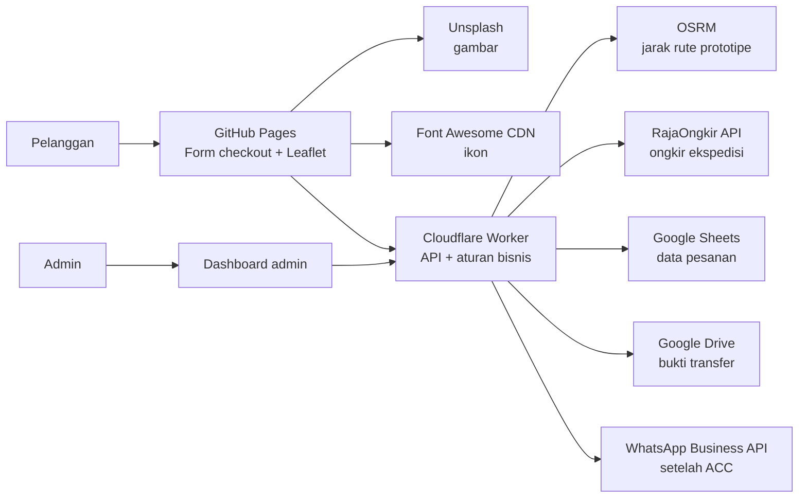

# Arsitektur Sistem

## Ringkasan

Situs pelanggan disajikan sebagai berkas statis dari GitHub Pages. Cloudflare Worker menjadi API/backend yang memvalidasi pesanan, menghitung ongkir, mengelola upload dan integrasi penyimpanan, serta mengatur status. Google Sheets menjadi penyimpanan data pesanan awal; file screenshot berada di Google Drive.

## Komponen dan tanggung jawab

| Komponen | Tanggung jawab |
| --- | --- |
| GitHub Pages | Menyajikan halaman publik pemesanan/checkout. Tidak menyimpan rahasia atau memutuskan status pembayaran. |
| Unsplash | Sumber foto sementara untuk visual frontend; gunakan URL/aset yang sesuai ketentuan Unsplash. |
| Font Awesome CDN | Menyediakan ikon frontend. Versi dan URL CDN dipilih saat implementasi. |
| Leaflet + OpenStreetMap | Menyediakan UI peta bagi pelanggan untuk memilih pin rumah. Atribusi dan kebijakan penyedia tile harus dipatuhi. |
| Cloudflare Worker | Worker `pemesanan-api` menyediakan endpoint RajaOngkir dan `/api/orders`. Endpoint order memvalidasi checkout, menghitung subtotal dari harga server, membuat kode pembayaran, lalu meneruskan order ke Apps Script. Endpoint admin belum dibangun. |
| OSRM | Menghasilkan estimasi jarak rute jalan untuk tarif ojol pada prototipe. Endpoint yang digunakan dan strategi pengganti perlu diputuskan. |
| RajaOngkir | Worker memakai API Shipping Cost V2 untuk mencari tujuan dan meminta tarif beberapa ekspedisi sekaligus. Hasil pencarian tujuan di-cache sebagai respons JSON pada Workers Cache selama 30 hari; tarif tetap dihitung langsung. Bobot item saat ini contoh 500 gram. |
| Google Sheets | Menyimpan order, alamat, kode referensi, rincian produk, ongkir, status pembayaran/pesanan, dan metadata bukti. Tab `Pesanan` dibuat otomatis oleh Apps Script saat endpoint order pertama kali dipakai. |
| Google Apps Script | Web App penghubung yang memeriksa token Worker dan menulis order secara idempoten ke Google Sheets. `SPREADSHEET_ID` dan `WORKER_SHARED_TOKEN` disimpan pada Script Properties. |
| Google Drive | Menyimpan screenshot bukti transfer. File tidak boleh dibagikan publik; dashboard mengambilnya melalui akses admin yang sah. |
| Dashboard admin | Membutuhkan autentikasi admin. Menampilkan pesanan/bukti dan menyediakan aksi ACC setelah pengecekan manual mutasi bank. |
| WhatsApp Business Platform/API | Mengirim notifikasi setelah admin ACC. Kredensial dan biaya pesan menjadi dependency yang perlu dipastikan. |

## Alur pemesanan dan pembayaran

1. Pelanggan memilih produk, memasukkan kontak/alamat tertulis, lalu mencari kelurahan/kecamatan/kota tujuan.
2. Frontend meminta hasil pencarian tujuan dari Worker. Pada cache miss Worker menghubungi RajaOngkir memakai secret API key di Cloudflare; hasilnya disimpan sebagai JSON di Workers Cache agar pencarian serupa berikutnya dapat memakai cache.
3. Setelah lokasi dipilih dan keranjang berisi produk, frontend meminta estimasi ongkir otomatis. Worker menggunakan ID asal Cimekar yang dicatat di `data/rajaongkir-reference.json`, menghitung berat prototipe 500 gram per item, dan meminta tarif beberapa ekspedisi sekaligus. Checkout menampilkan satu dropdown dengan kurir termurah terpilih. Saat dibuka, dropdown menampilkan maksimal dua alternatif reguler dan satu kurir dengan kargo jika tersedia; opsi lain berada di bagian “Kurir lainnya”. Setelah pelanggan memilih kurir, daftar layanan dan harga kurir itu tampil dari yang termurah. Setelah memilih layanan, daftar harga menutup dan dropdown utama menampilkan kurir beserta layanan/harga pilihannya. Layanan kargo diberi tanda jika dapat dikenali dari respons API. Tarif tetap diminta langsung dari RajaOngkir setelah tujuan dipilih dan keranjang berisi produk.
4. Worker menghitung subtotal dari daftar harga server, membuat order ID/kode referensi, lalu mengirim data ke Apps Script. Apps Script menulis pesanan berstatus menunggu pembayaran ke tab `Pesanan` dan mencegah duplikat untuk permintaan ulang dengan ID yang sama. Checkout menampilkan kode dan total setelah penyimpanan berhasil.
5. Pelanggan mencantumkan kode di deskripsi transfer dan mengunggah screenshot. Worker memvalidasi file, menyimpan file di Drive, dan mencatat referensi file/status bukti pada Sheet.
6. Admin membuka dashboard yang dilindungi akses, membandingkan kode, nilai, bukti, dan mutasi rekening secara manual.
7. Saat admin menekan ACC, Worker menyimpan status terlebih dahulu lalu meminta WhatsApp API mengirim konfirmasi. Kegagalan pengiriman harus tercatat dan tidak membatalkan status pembayaran yang sudah disetujui.

## Data dan keamanan

- Sheet menyimpan data terstruktur dan ID file; screenshot disimpan di Drive, bukan dimasukkan sebagai isi sel.
- Worker menghitung harga produk di server. Tarif ekspedisi pada tahap prototipe berasal dari layanan yang dipilih di browser; admin perlu mencocokkan total dan ongkir sebelum ACC manual.
- Apps Script Web App harus memeriksa `WORKER_SHARED_TOKEN` sebelum memproses aksi; token pasangannya disimpan sebagai secret `GOOGLE_SCRIPT_TOKEN` pada Worker.
- API key OSRM jika layanan yang dipilih memerlukan key, RajaOngkir, akses Google, dan WhatsApp disimpan sebagai secret di Cloudflare, bukan pada JavaScript publik.
- Key Shipping Cost RajaOngkir dibaca dari `ApiKey.txt` lokal dan disimpan pada secret Worker `RAJAONGKIR_API_KEY`; jangan commit file `ApiKey.txt` ke GitHub.
- Endpoint admin tidak boleh dapat dipanggil tanpa autentikasi/otorisasi.
- Validasi ukuran/tipe file, sanitasi input, batas request, dan aturan retensi bukti perlu ditentukan.
- Gambar Unsplash dan Font Awesome CDN adalah dependensi eksternal frontend; siapkan fallback bila gambar/font gagal dimuat dan hindari menjadikannya syarat untuk menyelesaikan checkout.
- Koordinat rumah, alamat, nomor telepon, dan bukti transfer adalah data pelanggan; akses dan periode penyimpanan perlu dibatasi.

## Keputusan yang belum final

- Cara Worker mengakses Sheets/Drive: Apps Script perantara atau Google API secara langsung.
- Mekanisme autentikasi dashboard admin.
- Endpoint/penyedia tile OSM serta layanan OSRM yang layak untuk tingkat penggunaan dan ketentuan usaha.
- Bobot aktual tiap produk dan paket/akurasi tarif RajaOngkir sebelum transaksi nyata.
- Penyedia WhatsApp Business/API dan biaya pesan.
- Format data produk khusus nomor rumah akrilik dan detail tarif kurir.
